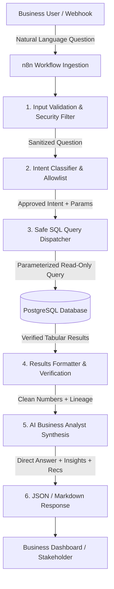
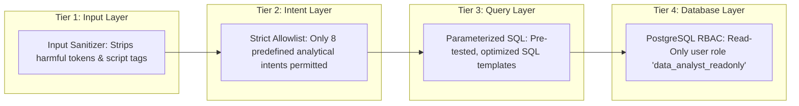

# System Architecture & Security Guardrails

## 1. System Overview

The **AI Data Analyst Agent** bridges the gap between natural language business inquiries and deterministic database calculations. In modern enterprise analytics, business stakeholders (CEOs, Sales Leads, Product Managers) ask conversational questions like:
- *"Which products generated the highest revenue?"*
- *"Are sales growing or declining month-over-month?"*
- *"Why is our profit margin dipping in certain categories?"*

Rather than having an AI model hallucinate plausible-sounding numbers, this system uses an **orchestrated, defense-in-depth pipeline**:

---

## 2. Security & Defense-in-Depth Model

A fundamental flaw in naive "Text-to-SQL" agents is allowing an LLM to generate and execute arbitrary SQL directly against a production database. In an enterprise environment, this introduces critical vulnerabilities:

1. **SQL Injection & Data Exfiltration**: Malicious users can trick the LLM via prompt injection into running `DROP TABLE`, `UPDATE`, or querying sensitive tables (salaries, passwords).
2. **Hallucinated Schemas & Calculations**: LLMs frequently invent non-existent column names, hallucinate incorrect aggregation formulas (e.g., summing profit margins instead of computing total profit / total sales), or miscalculate window functions.
3. **Denial of Service (DoS)**: An unconstrained query like `SELECT * FROM transactions CROSS JOIN users` can crash the database instance.

### The 4-Tier Guardrail Implemented in This Project:

| Guardrail Tier | Implementation | Protection Provided |
| :--- | :--- | :--- |
| **Tier 1: Input Sanitization** | Regex & token inspection in n8n Code Node | Blocks injection patterns (`DROP TABLE`, `UPDATE`, `;--`, `<script>`). |
| **Tier 2: Intent Allowlist** | Classification maps queries strictly to 8 approved analytical intents | Prevents execution of arbitrary or unreviewed SQL logic. |
| **Tier 3: Parameterized SQL** | Queries use typed parameter placeholders (`$1::DATE`, `$2::TEXT`) | Eliminates SQL concatenation attacks and ensures optimal query plans. |
| **Tier 4: PostgreSQL RBAC** | `data_analyst_readonly` role with `SELECT` grant only | Even if an unauthorized query bypasses upstream nodes, PostgreSQL rejects any write/DDL attempts. |

---

## 3. Component Breakdown & Technologies

### 1. n8n (Workflow Orchestration)
- **Role**: Acts as the central nervous system connecting user requests, query validation, database execution, and response synthesis.
- **Why n8n**: Provides visual execution transparency, robust error branches, low latency, and easy integration with external messaging (Slack, Teams, Webhook, REST APIs).

### 2. PostgreSQL 16 (Analytical Data Store)
- **Role**: Houses normalized e-commerce transactional records.
- **Indexes**: Indexed on `order_date`, `category`, `city`, and `product_name` to ensure sub-millisecond aggregation times.
- **Calculations**: Executes analytical SQL including `COUNT()`, `SUM()`, `ROUND()`, `AVG()`, window functions (`LAG() OVER (...)`), and Common Table Expressions (CTEs).

### 3. Python + Pandas (Data Quality & Verification)
- **Role**: Validates source CSV files before database ingestion (`data_validation.py`) and provides benchmark statistical validation (`analysis.py`).
- **Accounting Verification**: Verifies accounting identity $\text{Profit} = \text{Sales} - \text{Cost}$ across all records.

### 4. AI Business Analyst Synthesis (LLM)
- **Role**: Interprets the verified SQL data and translates raw numbers into an executive summary.
- **Key Prompt Rule**: The model is strictly instructed to distinguish **observed facts** (e.g., *"Budget Smartwatch generated ₹12,040 in losses"*) from **hypotheses** (e.g., *"This could indicate aggressive promotional discounting or high procurement costs"*). It is never permitted to invent financial numbers.

---

## 4. Analytical Metrics & Formula Reference

| Metric | Formula | Business Interpretation |
| :--- | :--- | :--- |
| **Total Revenue** | $\sum \text{sales}$ | Total gross revenue generated by orders. |
| **Total Cost** | $\sum \text{cost}$ | Cost of Goods Sold (COGS). |
| **Total Profit** | $\sum \text{profit} = \sum (\text{sales} - \text{cost})$ | Net gross profit before operating expenses. |
| **Profit Margin %** | $\left(\frac{\sum \text{profit}}{\sum \text{sales}}\right) \times 100$ | Percentage of revenue retained as profit. |
| **Average Order Value (AOV)** | $\frac{\sum \text{sales}}{\text{COUNT}(\text{orders})}$ | Average ticket size per transaction. |
| **Month-over-Month (MoM) Growth %** | $\left(\frac{\text{Rev}_t - \text{Rev}_{t-1}}{\text{Rev}_{t-1}}\right) \times 100$ | Time-series sales acceleration or deceleration. |
| **Statistical Anomaly Flag** | $\| \text{Rev}_t - \mu \| > 0.5 \times \sigma$ | Flags months deviating significantly from seasonal average. |
