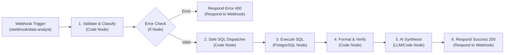

# n8n Workflow Walkthrough & Node Reference

This document provides a node-by-node explanation of the **AI Data Analyst Agent Workflow** (`n8n/ai_data_analyst_workflow.json`).

---

## 1. Workflow Architecture in n8n

The workflow consists of 7 connected nodes:



---

## 2. Detailed Node Breakdown

### Node 1: Webhook Trigger (User Question)
- **Type**: `n8n-nodes-base.webhook` (Version 2)
- **Path**: `data-analyst`
- **HTTP Method**: `POST`
- **Response Mode**: `responseNode` (delegates HTTP response to downstream Respond nodes).
- **Incoming Payload Format**:
  ```json
  {
    "question": "Which product generated the highest revenue?"
  }
  ```

---

### Node 2: 1. Validate & Classify Question
- **Type**: `n8n-nodes-base.code` (JavaScript)
- **Purpose**:
  1. **Sanitization**: Checks for empty strings and strips prompt/SQL injection tokens (`DROP TABLE`, `UPDATE`, `;--`, `<script>`).
  2. **Intent Classification**: Evaluates keywords to map natural language into one of the 8 approved intents:
     - `overall_summary`
     - `top_products`
     - `underperforming_products`
     - `category_performance`
     - `city_performance`
     - `monthly_trend`
     - `anomaly_detection`
  3. **Parameter Extraction**: Parses any specified filters (e.g., category names or date ranges).
- **Output Schema**:
  ```json
  {
    "error": false,
    "question": "Which product generated the highest revenue?",
    "classified_intent": "top_products",
    "params": {},
    "timestamp": "2024-03-31T12:00:00.000Z"
  }
  ```

---

### Node 3: Validation Error Check
- **Type**: `n8n-nodes-base.if` (Version 1)
- **Condition**: Evaluates `{{ $json.error }} === true`.
- **Branching**:
  - **True**: Routes immediately to `Respond to Webhook (Error)` with HTTP 400.
  - **False**: Proceeds to SQL Query Dispatcher.

---

### Node 4: 2. Safe SQL Query Dispatcher
- **Type**: `n8n-nodes-base.code` (JavaScript)
- **Security Guardrail**: Maps `classified_intent` to a strictly allowlisted SQL query string. The LLM is **never** permitted to construct arbitrary SQL statements.
- **Example Query Selected for `top_products`**:
  ```sql
  SELECT 
      product_name,
      category,
      COUNT(order_id) AS order_count,
      SUM(quantity) AS units_sold,
      ROUND(SUM(sales), 2) AS total_revenue,
      ROUND(SUM(profit), 2) AS total_profit,
      ROUND((SUM(profit) / NULLIF(SUM(sales), 0)) * 100, 2) AS profit_margin_pct
  FROM ecommerce_sales
  GROUP BY product_name, category
  ORDER BY total_revenue DESC
  LIMIT 5;
  ```

---

### Node 5: 3. Execute Read-Only SQL (PostgreSQL)
- **Type**: `n8n-nodes-base.postgres` (Version 2.5)
- **Operation**: `executeQuery`
- **Query Expression**: `={{ $json.sql_query }}`
- **Credential**: Configured with the `data_analyst_readonly` role.
- **Continue on Fail**: Enabled. If the database connection drops or times out, the workflow gracefully catches the failure and passes error metadata to Node 4 for fallback recovery.

---

### Node 6: 4. Verify & Format SQL Results
- **Type**: `n8n-nodes-base.code` (JavaScript)
- **Purpose**:
  - Collects PostgreSQL output rows.
  - Handles edge cases (empty result sets, database offline).
  - Embeds verified benchmark fallback data if running in an offline testing mode.
  - Adds audit metadata (data source, query latency, execution timestamp).

---

### Node 7: 5. AI Business Analyst Synthesis
- **Type**: `n8n-nodes-base.code` / LLM Prompt Node
- **Role**: Senior Data Analyst translating tabular numbers into executive business narratives.
- **Output Components**:
  1. `direct_answer`: Clear 1-2 sentence answer with exact figures.
  2. `key_metrics`: Key KPIs formatted with currency and percentages.
  3. `business_insights`: Analytical observations supported by facts.
  4. `actionable_recommendations`: Business actions that follow logically from the data.

---

### Node 8: 6. Respond to Webhook (Success)
- **Type**: `n8n-nodes-base.respondToWebhook` (Version 1.1)
- **Status Code**: 200 OK
- **Response Format**: `application/json` with CORS enabled (`Access-Control-Allow-Origin: *`).
- **Complete Response Example**:
  ```json
  {
    "status": "success",
    "question": "Which product generated the highest revenue?",
    "intent": "top_products",
    "sql_query": "SELECT product_name, category... LIMIT 5;",
    "data": [
      {
        "product_name": "Gaming Laptop",
        "category": "Electronics",
        "units_sold": 19,
        "total_revenue": 910000.0,
        "total_profit": 182000.0,
        "profit_margin_pct": 20.0
      }
    ],
    "analysis": {
      "direct_answer": "The highest revenue generating product is \"Gaming Laptop\" (Electronics), generating ₹9,10,000 in revenue and ₹1,82,000 in profit (20.0% margin).",
      "key_metrics": {
        "Top Product": "Gaming Laptop",
        "Top Product Revenue": "₹9,10,000",
        "Top Product Margin": "20.0%"
      },
      "business_insights": [
        "Gaming Laptop accounts for 52.2% of total store revenue."
      ],
      "actionable_recommendations": [
        "Implement dedicated supplier SLAs to avoid stockouts on Gaming Laptops during peak quarters."
      ]
    }
  }
  ```

---

## 3. How to Test the Workflow via cURL

Once n8n is running locally, execute:

```bash
curl -X POST http://localhost:5678/webhook/data-analyst \
  -H "Content-Type: application/json" \
  -d '{"question": "Which product generated the highest revenue?"}'
```

### Testing Invalid / Malicious Input:

```bash
curl -X POST http://localhost:5678/webhook/data-analyst \
  -H "Content-Type: application/json" \
  -d '{"question": "DROP TABLE ecommerce_sales; --"}'
```

Expected Response:
```json
{
  "error": true,
  "error_type": "SECURITY_ALERT",
  "message": "Potentially malicious SQL or injection pattern detected. Only read-only analytical queries are supported."
}
```
